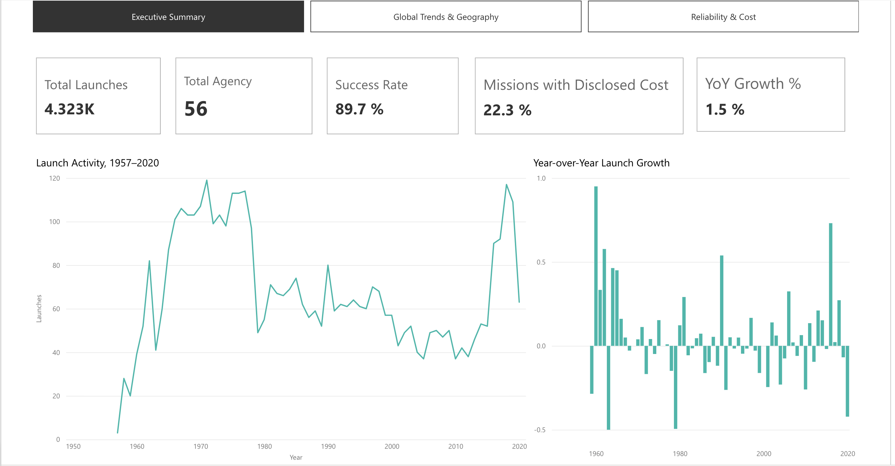
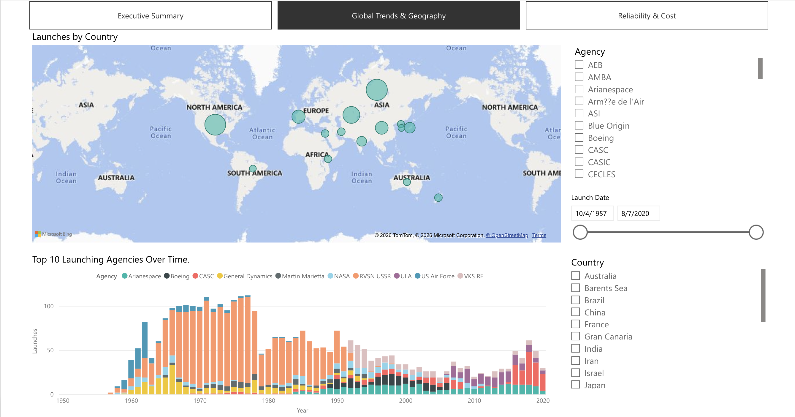
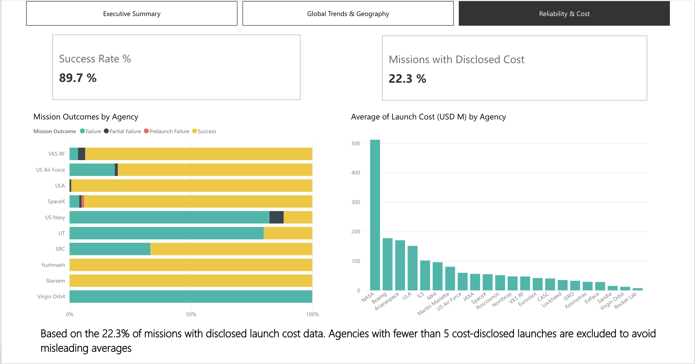
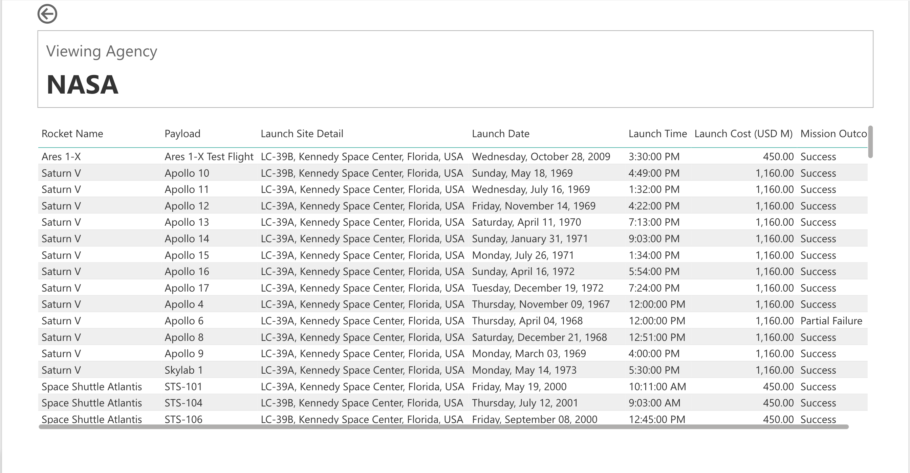

# 🚀 Beyond Earth: Global Space Launch Intelligence

An end-to-end Power BI dashboard analyzing 60+ years of global space missions from Sputnik in 1957 through 2020 — built entirely in Power BI Service.

**[🔗 View the live interactive dashboard](https://app.powerbi.com/view?r=eyJrIjoiZGNjYTI1NWYtNmI5Yi00MDY0LTkxYmUtMjA0OWYyOTcyYjg4IiwidCI6ImQxZjE0MzQ4LWYxYjUtNGEwOS1hYzk5LTdlYmYyMTNjYmM4MSIsImMiOjEwfQ%3D%3D)**

## 📊 Overview

This project transforms a raw, messy Kaggle dataset (4,324 rows, "All Space Missions from 1957") into a fully modeled, 3-page BI dashboard with a hidden drill-through page for mission-level exploration. It demonstrates the full analytics workflow: data profiling, Power Query cleaning, data modeling, DAX measures, and interactive report design.

- **Dataset:** All Space Missions from 1957 (Kaggle)
- **Tool:** Power BI Service
- **Final size:** 4,323 rows × 11 cleaned columns

## 🗂️ Pages

### 1. Executive Summary

Top-line KPIs (Total Launches, Total Agencies, Success Rate, % Missions with Disclosed Cost), a 60-year launch activity trend, and a Year-over-Year growth chart.

### 2. Global Trends & Geography

A world map of launches by country, paired with a stacked timeline of the top 10 launching agencies over time.

### 3. Reliability & Cost

Mission outcome breakdown by agency and average launch cost by agency — filtered to exclude agencies with fewer than 5 cost-disclosed launches, to avoid misleading averages from small sample sizes.

### 4. Mission Explorer (drill-through)

A hidden drill-through page. Right-clicking any agency elsewhere in the report opens a filtered, mission-level table for that agency, with a dynamic page title confirming the selection.

## 🧠 Key Analytical Decisions

**1. Preserved nulls instead of zero-filling**
Launch Cost had a 78% null rate. Rather than filling missing values with 0 (which would understate costs), I added a binary `Has Cost Data` flag and built the cost KPIs to calculate only against disclosed values — preserving data integrity over convenience.

**2. Caught a misleading YoY chart before shipping it**
An early single-card YoY Growth measure showed 1.5% — but that number hid an 833% spike in 1958 (28 launches vs. a base of just 3 in 1957), which was compressing 60 years of real trend data into an unreadable flat line. I identified the root cause, verified it with the actual launch counts, and filtered the chart to start from 1959 — a defensible analytical call, not just a convenient one.

**3. Only 1 of 5 "duplicate" timestamps was a true duplicate**
Initial profiling flagged 5 rows sharing launch timestamps. Rather than removing all 5, I investigated each and found 4 were distinct missions that happened to share a launch time — only 1 was a genuine duplicate and was removed.

**4. Rejected merging a second dataset**
An early idea to merge a second dataset for recency was scrapped due to data lineage risk, duplicate reconciliation complexity, and the risk of contaminating the analysis with speculative future data. Single-source discipline was the safer, more defensible choice for a portfolio piece.

## 🛠️ Built With

- Power BI Service (web-only)
- DAX measures (Success Rate %, YoY Growth %, Missions with Disclosed Cost %)
- Modeled Date table with a proper relationship

## 📁 Repo Contents

- `screenshots/` — dashboard page exports
- `README.md` — this file
